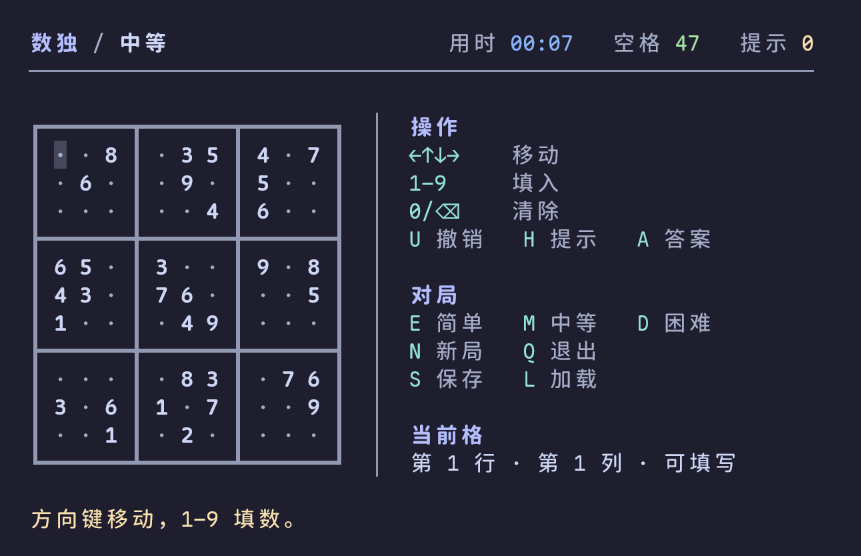
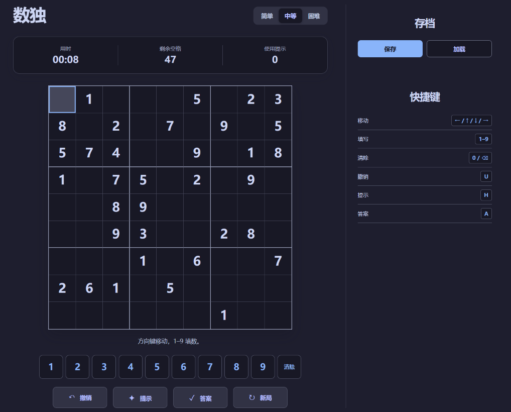

# 数独

使用 TypeScript 实现的数独游戏，提供终端界面和浏览器界面。

## 界面

### 终端界面

前往 <https://github.com/Juemuren/sudoku/releases> 下载可执行程序。

### 浏览器界面

前往 <https://juemuren.github.io/sudoku/> 访问站点。

## 文档

- 技术栈文档 [TECH.md](docs/TECH.md)
- 开发文档 [DEV.md](docs/DEV.md)
- 持续集成文档 [CI.md](docs/CI.md)
- 架构文档 [ARCHITECTURE.md](docs/ARCHITECTURE.md)
- 规划文档 [PLAN.md](docs/PLAN.md)
