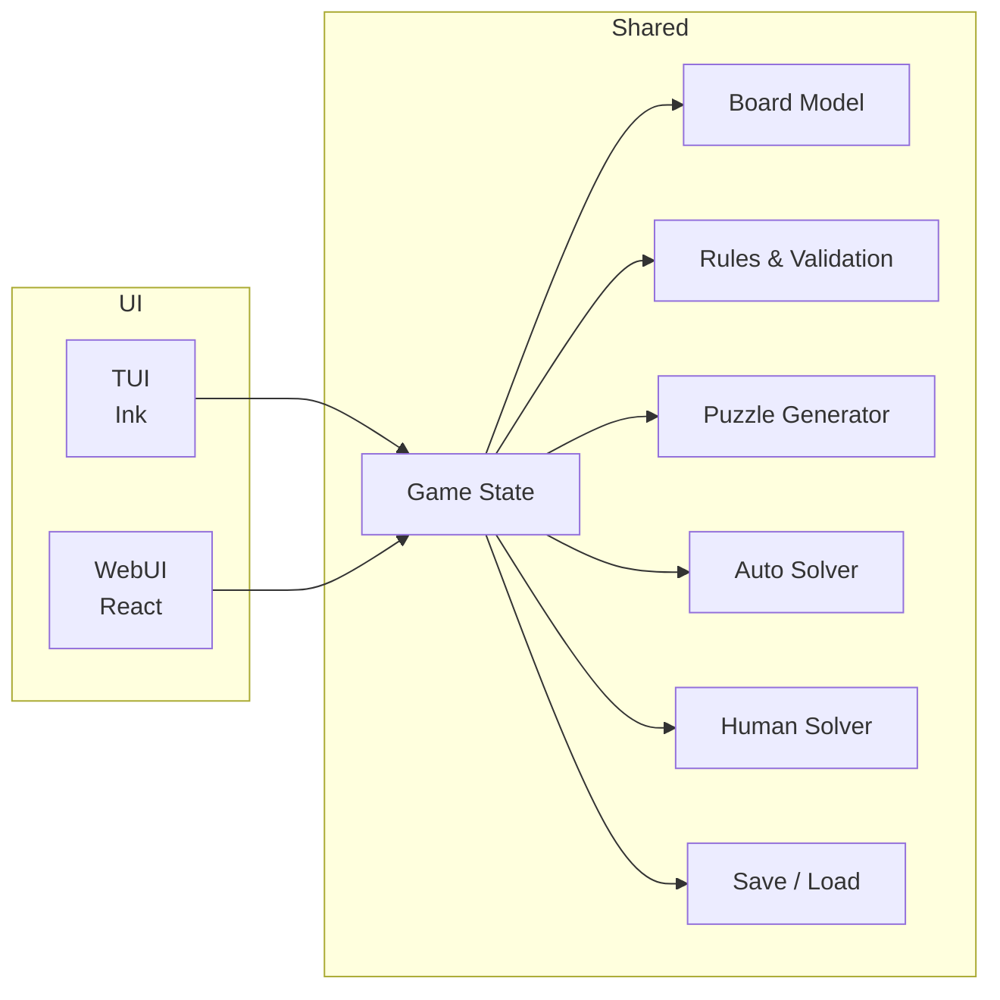

# 开发文档

## 技术栈

包管理器使用 pnpm 12，运行时为 Node.js 26

- 游戏逻辑使用 TypeScript
- WebUI 使用 React
- TUI 使用 Ink
- 自动求解器使用 z3
- 打包使用 Vite
- 静态检查和格式化使用 Biome

## 架构

整体架构大致为



项目结构大致为

```txt
src/
  ui/
    tui/
    webui/
  app/
    gameState.ts
    useCases/
      newGame.ts
      enterValue.ts
      requestHint.ts
      autoSolve.ts
  domain/
    board.ts
    rules.ts
    validator.ts
    generator.ts
  solvers/
    auto/
      z3Solver.ts
      backtrackingSolver.ts
      cpSatSolver.ts
    human/
      strategies/
      hintEngine.ts
      difficultyEvaluator.ts
```

目前实现共享游戏逻辑和 TUI；WebUI、存档、人类解题策略和 z3 求解器尚未实现。
