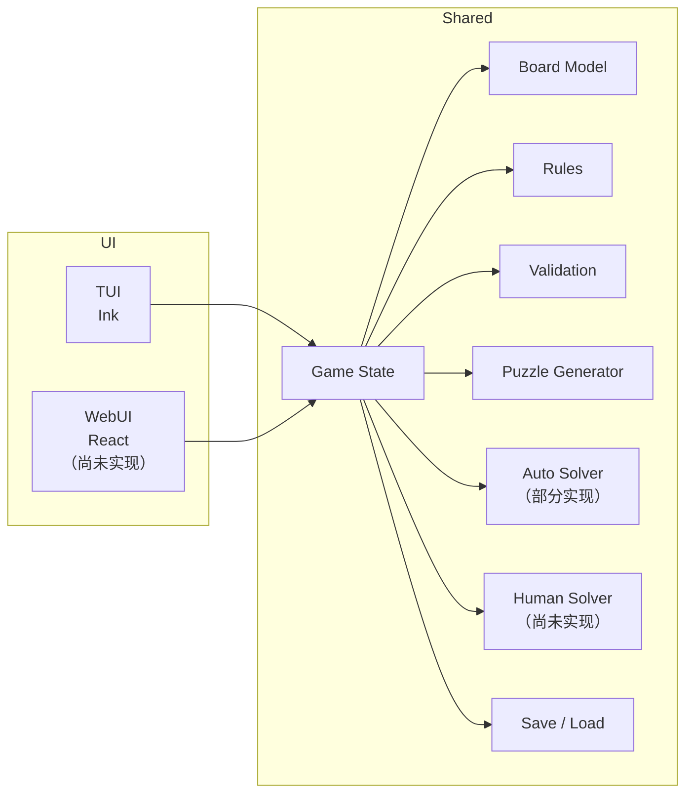

# 开发文档

## 技术栈

主要工具

- 运行环境为 Node.js 26
- 包管理器使用 pnpm 12
- 游戏逻辑使用 TypeScript

对于 UI

- WebUI 使用 React
- TUI 使用 Ink
- 打包使用 Vite

对于检查和测试

- Lint 和 Format 使用 Biome
- Test 使用 Node.js 测试模块
- JSON Schema 验证使用 Zod

## 架构规划



## 项目结构

```txt
src/
  ui/
    tui/
    webui/
  app/                游戏逻辑
  storage/            存档
  domain/
    board.ts          棋盘模型
    rules.ts          游戏规则
    generator.ts      生成器
    solver.ts         求解器
```
